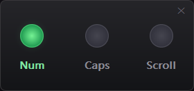
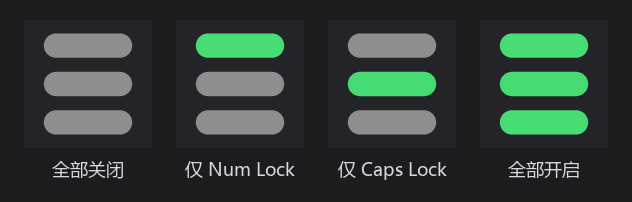
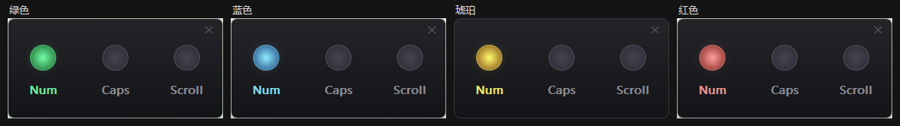
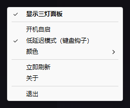

# 键盘指示灯

Windows 任务栏里的键盘指示灯：Caps Lock / Num Lock / Scroll Lock。单个 exe，无第三方依赖、无网络访问、不写日志。

*A tray indicator for the Caps Lock / Num Lock / Scroll Lock keys, written in C with the Win32 API.*



## 托盘图标

三根横条，从上到下依次是 **Num / Caps / Scroll**，亮灯彩色、灭灯灰色。下图按 128px 渲染（托盘里实际是 16px）：



## 功能

- 托盘常驻，悬停可看三个键的状态
- 左键单击打开三灯面板：圆角、抗锯齿、自动隐藏，位置会记住
- 四套配色：绿 / 蓝 / 琥珀 / 红，深色与浅色任务栏自动适配
- 按键即时响应，不会有一秒半秒的延迟
- 高 DPI、深色主题、资源管理器重启后都能自动恢复
- 单实例运行，重复启动只会把面板叫出来

## 配色



右键菜单 → 颜色 切换，选择会保存。

## 安装

```bat
install.bat
```

复制到 `%LOCALAPPDATA%\Programs\KeyLockIndicator`，并在桌面和开始菜单创建快捷方式。卸载时删掉这个目录和快捷方式即可。

## 使用

| 操作 | 效果 |
|---|---|
| 悬停托盘图标 | 显示三个键的状态 |
| 左键单击 | 打开 / 收起三灯面板 |
| 再次双击 exe | 打开面板（不会启动第二个进程） |
| 拖动面板 | 任意位置按住拖动，位置会被记住 |

右键菜单：



## 编译

需要 Visual Studio 2019/2022（勾选「使用 C++ 的桌面开发」）和 Windows SDK：

```bat
build.bat
```

脚本会用 `vswhere` 自动定位 Visual Studio；也可以用环境变量 `VCVARS` 指定自己的 `vcvars64.bat`。

## 关于管理员权限

程序清单里声明了 `requireAdministrator`，启动时以管理员身份运行（UAC 关闭或设为不提示的机器上是静默的，默认设置下会弹一次确认框）。

不需要管理员权限的话，把 `res/app.manifest` 里的 `requireAdministrator` 改成 `asInvoker` 重新编译即可——这个程序本身只读取键盘状态。

## License

MIT
